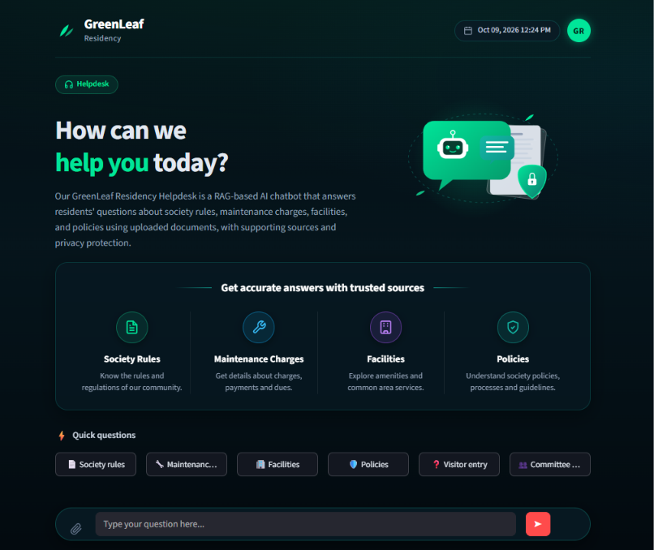

# GreenLeaf Residency Helpdesk

A Retrieval-Augmented Generation (RAG) application that answers residents' questions using GreenLeaf Residency documents.

The application retrieves relevant document chunks, generates answers using the Groq API, and displays supporting sources through a Streamlit interface.

## Application Screenshot



## Features

- PDF, DOCX, Markdown, and TXT document ingestion
- Text cleaning and sensitive-data masking
- Semantic search using FastEmbed and ONNX Runtime
- Local vector storage using Qdrant
- AI-powered answers using Groq
- Source attribution with document metadata
- Effective-date handling for conflicting policies
- Incremental indexing of updated notices
- Streamlit user interface
- Automated RAG and UI tests

## Technology Stack

| Component | Technology |
|---|---|
| Programming language | Python |
| User interface | Streamlit |
| RAG framework | LangChain |
| Vector database | Qdrant |
| Embedding model | FastEmbed (`sentence-transformers/all-MiniLM-L6-v2`) |
| Language model API | Groq |
| Document processing | PyPDF, Docx2txt |
| Testing | pytest, Streamlit AppTest |

## Project Structure

```text
greenleaf-residency-helpdesk/
├── data/
│   ├── raw/                 # Original society documents
│   ├── updates/             # Revised and new notices
│   └── processed/           # Generated cleaned documents and chunks
├── src/
│   ├── answer.py
│   ├── build_index.py
│   ├── chunk_text.py
│   ├── clean_text.py
│   ├── config.py
│   ├── index_updates.py
│   ├── load_documents.py
│   └── retrieve.py
├── tests/
│   ├── test_rag.py
│   └── test_streamlit_app.py
├── app.py
├── requirements.txt
├── README.md
├── RESULTS.md
└── .gitignore
```

## Prerequisites

- Python 3.12
- A Groq API key
- Internet access for initial model downloads and Groq API calls

## Installation

Clone the repository:

```powershell
git clone https://github.com/santhoshreddy0047-lgtm/Greenleaf-residency-helpdesk.git
cd Greenleaf-residency-helpdesk
```

Create and activate a virtual environment on Windows:

```powershell
python -m venv .venv
.\.venv\Scripts\Activate.ps1
```

Install dependencies:

```powershell
python -m pip install -r requirements.txt
```

Create a `.env` file in the project root and add your own API key:

```dotenv
GROQ_API_KEY=your_groq_api_key_here
```

Do not commit your `.env` file or share your API key.

## Prepare the Document Index

Place authorized source documents in `data/raw/`.

Build the index:

```powershell
python -m src.build_index
```

Index revised documents placed in `data/updates/`:

```powershell
python -m src.index_updates
```

Generate cleaned document and chunk outputs:

```powershell
python -m src.chunk_text
```

## Run the Application

```powershell
streamlit run app.py
```

Open the local address printed by Streamlit in your browser.

## Run Tests

Run the mocked RAG and Streamlit tests:

```powershell
python -m pytest tests/test_rag.py tests/test_streamlit_app.py -v
```

## Results

See [RESULTS.md](RESULTS.md) for the recorded automated test results, functional question tests, update verification, privacy checks, and known limitations.

## Privacy and Security

- Store API credentials in `.env`.
- Do not commit `.env`, local vector database files, or generated processed data.
- Use only documents you are authorized to process and publish.
- The confidential complaint log is excluded from Git tracking.
- Sensitive-data masking is applied during document processing. This is a safeguard, not a guarantee that every personal detail will be removed.

## Limitations

- Answer quality depends on document quality and retrieval relevance.
- Some retrieved sources may not directly support every answer.
- Privacy and source attribution require continued testing.